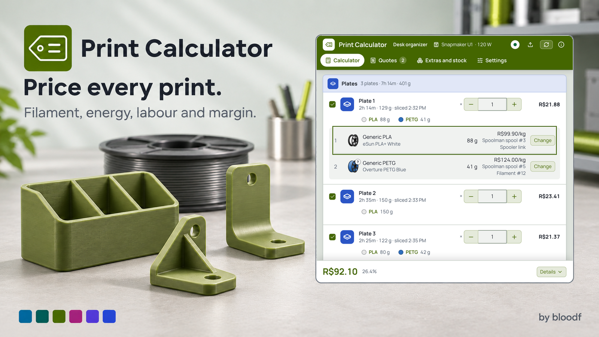
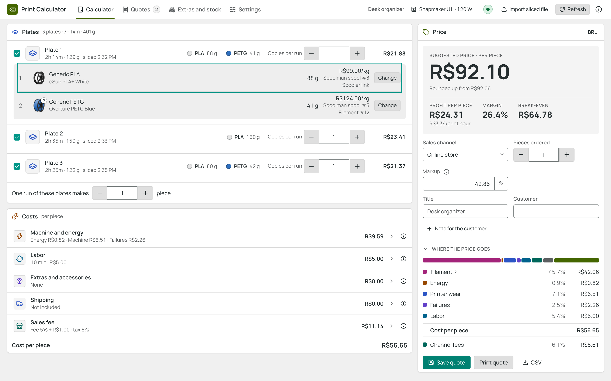
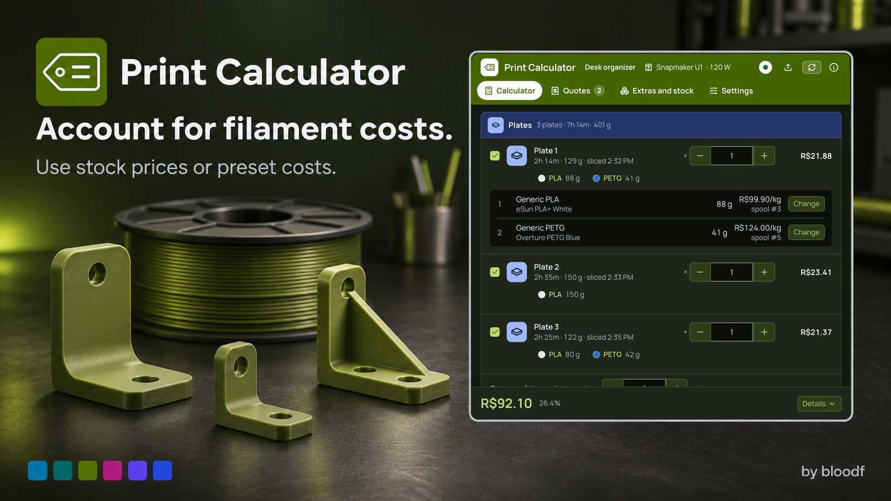
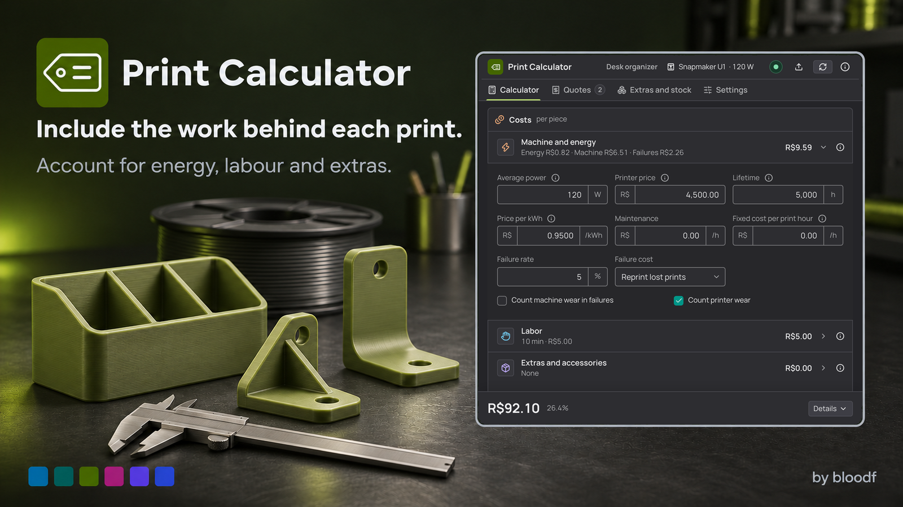
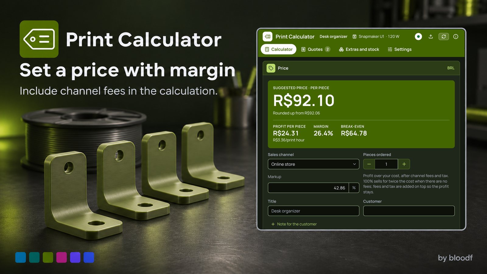
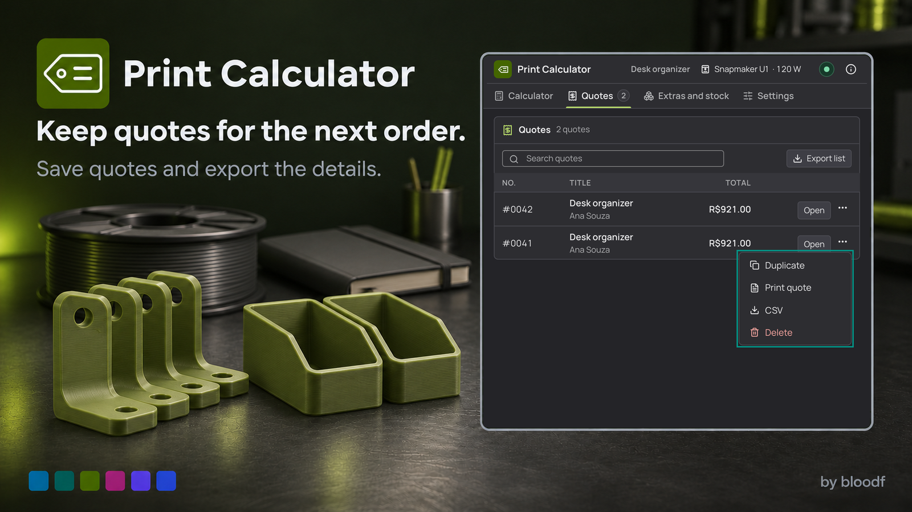
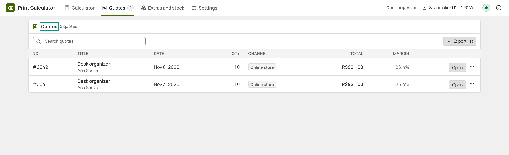

  <picture>
    <source media="(prefers-color-scheme: dark)" srcset="assets/readme/orca_print_calculator-hero-dark-en.png">
    
  </picture>

<h1 align="center">💰 Print Calculator</h1>

<b>Price every plate: filament, energy, labour, fees and margin.</b> An OrcaSlicer plugin · by bloodf

  
  
  
  

  <a href="#-install">Install</a> · <a href="#-features">Features</a> · <a href="#-how-to-use">How to use</a> · <a href="#-faq">FAQ</a> · <a href="README.pt-BR.md">Português</a>

## ✨ What it does

Print Calculator adds a tab to OrcaSlicer that prices every build plate of the open project. Slice a plate and it shows up with its print time, the grams of each filament and what they cost. Filament prices come from your Spoolman spools or from the filament preset, electricity from your printer's power, and you add labour, extras, shipping, tax and the fees of the place where you sell. You get a suggested price per piece with profit, margin and break-even, which you can save as a quote, print, or export.

  <picture>
    <source media="(prefers-color-scheme: dark)" srcset="docs/screenshots/calculator-dark-en.png">
    
  </picture>

## 📦 Install

The plugin is on Orca Cloud: [cloud.orcaslicer.com/p/521c07cf6de2](https://cloud.orcaslicer.com/p/521c07cf6de2). Subscribe there, then in OrcaSlicer open **Plugins**, refresh and enable it. To install from a file instead:

1. Download `orca_print_calculator_any.whl` from the [latest release](https://github.com/bloodf/orca_print_calculator/releases/latest). `SHA256SUMS` beside it has the checksum.
2. Copy it into `~/Library/Application Support/OrcaSlicer/orca_plugins/orca_print_calculator/` (create the folder, and remove any older `.whl` in it).
3. Restart OrcaSlicer, open **Plugins** and enable **orca_print_calculator**. OrcaSlicer shows a permission prompt. Leave full access off.

| Requirement | Detail |
|---|---|
| OrcaSlicer | 2.5 or newer |
| Spoolman | Optional. Without it the plugin uses the cost stored in each filament preset, or a price you type |
| Printer | Any. Only G-code from a Snapmaker U1 has been checked against real files (see the [FAQ](#-faq)) |
| Status | In development. Tested with a mock host, not yet verified inside OrcaSlicer ([live-run procedure](docs/live-run.md)). Every screenshot here is the plugin's page in a browser with sample data and a mock host |

## 🧰 Features

<table>
  <tr>
    <td width="50%" valign="top">
       
      <b>Filament cost</b> 
      Each filament slot is priced per kg from the Spoolman spool it matches. With no match it uses a price you typed or the preset cost, and labels which one.
    </td>
    <td width="50%" valign="top">
       
      <b>Machine, energy and labour</b> 
      Printer power, price per kWh, printer wear, failure rate, labour, extras and shipping are added to every piece.
    </td>
  </tr>
  <tr>
    <td width="50%" valign="top">
       
      <b>Price with margin</b> 
      A markup over cost gives a price per piece that keeps its profit after the channel's fee and tax, with margin and break-even beside it.
    </td>
    <td width="50%" valign="top">
       
      <b>Saved quotes</b> 
      A quote keeps its own plates, prices and currency. Open it later, duplicate it, print it or export it.
    </td>
  </tr>
</table>

| | Feature | What you get |
|---|---|---|
| | Plates | One row per sliced plate with time, grams per filament slot and cost, an include checkbox and a copies stepper. "One run of these plates makes N pieces" sets how many pieces a full set of plates produces. |
| | Slicing | The plugin reads the G-code OrcaSlicer writes when you slice. "Slice all" fills every plate, one after another. |
| | Out-of-date warning | When something changes after a slice, the tab marks the project "may be out of date". |
| | Sliced file import | **Import sliced file** reads plates from a `.gcode.3mf` exported with File, Export, Export all sliced file (up to 100 MB). Imported plates stay on screen when you slice; a "New slice" notice offers "Use it". |
| | Printer power | Average watts are suggested from the printer model and marked "Estimated". Models with no entry get a generic 120 W. Your own value wins. |
| | Cost sections | **Machine and energy** (power, printer price and lifetime, price per kWh, maintenance, fixed cost per print hour, failure rate), **Labor**, **Extras and accessories**, **Shipping** and **Sales fee**. |
| | Extras and stock | A catalogue of extras with an optional count on hand, and a read-only summary of your Spoolman filament. The calculator warns when a quote needs more than you have. Nothing is deducted. |
| | Sales channels | Your own channels, each with a percent fee, a fixed fee, tax and optional price tiers. **Compare channels** shows them side by side. |
| | Rounding and minimum | A minimum order amount and four rounding modes: Exact, Round (3 digits), Ends in 9, Ends in 0 or 5. Rounding always goes up. |
| | Batch pricing | Quantity, discount tiers and a table with unit cost, unit price, order total, order profit and margin per tier. |
| | Quote sheet | **Print quote** opens an itemised or summary sheet and the print dialog, where you can save a PDF. The sheet carries your logo, company details, payment terms and accent colour. |
| | Export | CSV and HTML files go to the plugin data folder and the tab shows the path. **Export list** in the Quotes tab writes one CSV row per quote shown. |
| | Starting values | In BRL, USD and EUR every cost starts with a typical value (price per kWh, labour rate, printer price and lifetime, 5% failure rate, 100% markup). Other currencies start empty. |
| | Settings | One page with every group (Spoolman, costs, pricing, sales channels, printers, quote sheet, language and currency, about) and an index that jumps to each. Changes save on their own. |
| | Currency and theme | Any currency, taken from Spoolman or set in Settings. The page is built to follow OrcaSlicer's dark and light themes, in lime with a deep green bar; this is not verified inside OrcaSlicer yet. |

## 🛠️ How to use

1. Open the **Print Calculator** tab. On the first run, **Set up once** asks for three things: filament prices (connect Spoolman, or skip and use preset prices), the energy price and your hourly rate. If Spooler is installed, it offers the Spoolman address Spooler already uses.
2. To connect Spoolman later, open **Settings**, type the **Spoolman address** (for example `http://localhost:7912`) and press **Test connection**. OrcaSlicer asks once whether the plugin may reach that address.
3. Slice a plate, or use "Slice all". Each plate appears under **Plates**. Press **Refresh** if one is missing, or use **Import sliced file** for a `.gcode.3mf`.
4. Click the filament chips of a plate to see the price per kg of each slot. **Change** picks another spool or lets you type a price per kg.
5. Open the sections under **Costs** and fill in what applies: **Machine and energy**, **Labor**, **Extras and accessories**, **Shipping**, **Sales fee**.
6. In **Price**, choose the **Sales channel**, the **Pieces ordered** and the **Markup**. **Where the price goes** splits the price by cost line, fees, tax and profit.
7. Press **Save quote**. Then **Print quote** for a sheet or a PDF, or **CSV** for a file. Saved quotes are in the **Quotes** tab.

  <picture>
    <source media="(prefers-color-scheme: dark)" srcset="docs/screenshots/quotes-dark-en.png">
    
  </picture>

## 🔒 Privacy and safety

No telemetry. Nothing leaves your machine except requests to the Spoolman address you entered. The plugin only reads from Spoolman and never writes to it. It is not connected to any marketplace: channel fees are the numbers you type.

| Access | Why |
|---|---|
| `threading` | Fetch from Spoolman without freezing the window. |
| Read access to OrcaSlicer's temporary slicing folder | Read the G-code OrcaSlicer writes for each plate. |
| Network, only to the Spoolman address you enter | Read spools, filaments and currency. Only redirects within the same address are followed. |
| Files in the plugin's own data folder | Store settings and quotes, write exports and the log. |

The plugin does not ask for full access.

Its data folder is `orca_plugins/plugin_data/<plugin name>/` inside OrcaSlicer's data folder. The `<plugin name>` is not confirmed yet (see [docs/live-run.md](docs/live-run.md)).

| File | What it holds |
|---|---|
| `settings.json`, `quotes.json` | Your settings and saved quotes. Each file is capped at 16 MiB when saved; if quotes grow past that, delete old ones. |
| `exports/` | The CSV and HTML files you export. |
| `plugin.log` | A rotating log of 512 kB with one backup. It records plate captures and errors, and never your Spoolman address. |

Prices from the calculator are suggestions. Review them before you quote a customer, and check channel fees against each platform's current fee table.

## ❓ FAQ

Where does the file go on Linux and Windows, and why is Orca Cloud behind GitHub?

On macOS the steps above use `~/Library/Application Support/OrcaSlicer/orca_plugins/orca_print_calculator/`. On Linux and Windows the folder is `orca_plugins/orca_print_calculator/` inside OrcaSlicer's data folder. Those paths are not verified.

Orca Cloud lists a version only after its release is published, so it can be behind this repository.

How do I link a filament slot to a Spoolman spool?

Click the filament chips of a plate, then **Change** on the slot, and pick a spool or type a price per kg. Without a pick, each slot is matched in this order and the first match wins:

1. A spool you picked by hand for that preset ("Picked").
2. The Spooler plugin mapping, if you use Spooler.
3. `(#ID)` in the filament preset name.
4. `Spoolman filament N` in the preset's `filament_notes`.
5. No match: a price per kg you typed for that preset ("Typed"), else the preset `filament_cost` per kg, labelled "Preset price".

A slot with no price counts as 0 and the price panel says so. A slot matched to a Spoolman filament that has no price (no priced spool, no filament price) is priced the same way: typed price, then preset price.

The price per kg comes from the most recently used spool that is not archived (spool price divided by initial weight). Without one it comes from the filament price divided by the filament weight.

How is the suggested price worked out?

Markup over cost. The suggested price is the lowest price whose profit, after the channel's fees and tax, is at least the markup times the cost. With no fees, 100% sells for twice the cost. A channel with a 20% fee sells a 10.00 cost at 25.00, so 10.00 profit stays after the fee. The "Margin" figures are profit as a share of the price.

How are channel fees charged on an order of several pieces?

Fees are worked out on the price of one piece and multiplied by the quantity. The fixed fee is charged per piece sold, not once per order, and price tiers pick their band from the per-piece price.

What happens when a run makes more pieces than the order needs?

The spare pieces are charged to the order. Each cost line is rounded once on the whole order, not per piece (calculation version 2), and the markup is measured on cost after fees and tax (calculation version 3). Quotes saved earlier keep the numbers they were saved with. "Reprice with the current calculation", in the quote's own notes, applies the current calculation on purpose.

Why can't I print or export a quote?

Something the slice did not report (print time, filament weight or usage, a filament price) is saved as unknown, never as zero. You can save such a draft, but it cannot be exported, printed or sent until it is complete. The list under the price says what is missing.

Will a saved quote change when I change my settings?

No. A quote keeps its own inputs, plates, prices and currency. Opening it later shows the numbers as saved, even if you changed settings or currency since.

How do I get the right power for my printer?

Measure a print with a smart plug: kWh divided by print hours, times 1000, is the average watts. Type that value and it replaces the estimate.

What does the stock warning count?

For extras, every row of the same item together: per piece (spares included), per plate copy and run, and per order. For filament, the tab notes when a quote prints more of a Spoolman filament than its spools that are not archived have left, counting every plate copy and run. Filament with no remaining weight in Spoolman is not checked. Nothing is deducted automatically.

What does "may be out of date" miss?

OrcaSlicer does not say which plate changed, so the tab marks the whole project. It misses mirroring, centring, unsaved setting changes and plates reordered by drag. Slice again after those.

Has it been tested inside OrcaSlicer?

Not yet. The page and the pricing engine are tested outside OrcaSlicer with a mock host, and the Python host against a fake `orca` module. Nothing has run against a real OrcaSlicer, Spoolman server or printer. The procedure for that is in [docs/live-run.md](docs/live-run.md).

Known limits until then:

- G-code parsing for Bambu Lab printers rests on synthetic fixtures, and real Bambu output may differ. The only real fixtures come from a Snapmaker U1.
- Linux and Windows temp-folder paths, printing and the file picker are unverified.
- Plate thumbnails are not shown.
- The first slice of a plate relies on the plate that is selected when slicing ends. Switching plates during that first slice can put the numbers on the wrong plate. Later slices of the same plate are matched correctly.
- OrcaSlicer's plugin API has no call to merge or hide tabs, so this tab sits beside the tabs of other plugins (Spooler, U1 Control).

No plates appear. What now?

Slice a plate in OrcaSlicer, press **Refresh**, or import a sliced `.gcode.3mf`. Check `plugin.log` for `G-code read failed`.

What do the Spoolman errors mean?

"Can't reach Spoolman at that address" means the address or network is wrong. "That address answered, but it isn't Spoolman" means a different service answered. "Access was not allowed in OrcaSlicer. Save the address again to get the prompt." means you denied the permission prompt. "Spoolman redirected to another address" means you should enter the final address. While Spoolman is offline, filament uses preset prices.

What do the other error messages mean?

"Couldn't reach OrcaSlicer": the tab lost its connection to the host. Reopen the tab, or restart OrcaSlicer if it repeats. "Details" shows the error.

"Saved ... could not be read, so changes are not being saved": the plugin cannot read `settings.json` or `quotes.json`. Check the file permissions in OrcaSlicer's data folder. The files are not overwritten.

"Some saved settings were invalid and were reset to defaults": a value in `settings.json` failed validation and went back to its default. The notice names the settings.

## 🌍 Languages

English, Brazilian Portuguese, Spanish, German and Simplified Chinese. With Language set to Auto it follows OrcaSlicer; Settings lets you pick one.

## 🧩 More plugins by bloodf

| | Plugin | What it does | |
|:-:|---|---|---|
|  | 🧩 [Organizer](https://github.com/bloodf/orca_organizer) | Arrange parts by their real outline and fill a plate with more copies. | [Install](https://cloud.orcaslicer.com/p/5bf381fd42d4) |
|  | 🧲 [Embedder](https://github.com/bloodf/embedder) | Magnet and NFC pockets, with the pause at the right layer. | [Install](https://cloud.orcaslicer.com/p/58222d4f9e52) |
|  | 💰 **Print Calculator** · you are here | Price every plate: filament, energy, labour, fees and margin. | |
|  | 🧵 [Spooler](https://github.com/bloodf/spooler) | Your Spoolman stock inside OrcaSlicer, with what is left on each spool. | [Install](https://cloud.orcaslicer.com/p/50c35dcbd6f3) |
|  | 🟣 [Kobra Control](https://github.com/bloodf/kobracontrol) | Run the Anycubic Kobra X from OrcaSlicer over your LAN. | [Install](https://cloud.orcaslicer.com/p/59c786285255) |
|  | 🔵 [U1 Control](https://github.com/bloodf/u1control) | Run the Snapmaker U1 from OrcaSlicer: toolheads, camera, files. | [Install](https://cloud.orcaslicer.com/p/55b8c347d443) |

Each plugin works on its own; installed together they share data where it helps.

## 🤝 Contributing

Start with [CONTRIBUTING.md](CONTRIBUTING.md). Build, tests and the host contract are in [docs/development.md](docs/development.md), releases in [docs/release.md](docs/release.md), the interface specification in [docs/ux.md](docs/ux.md) and brand rules in [brand/BRAND.md](brand/BRAND.md). Changes per version are in [CHANGELOG.md](CHANGELOG.md).

## 📄 License

MIT. See [LICENSE](LICENSE).

by bloodf

