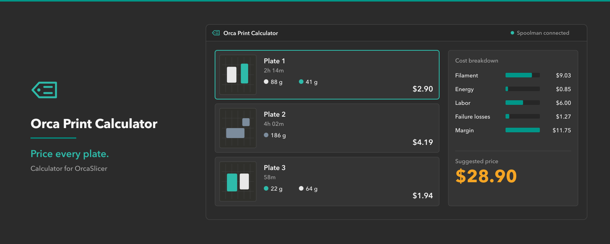
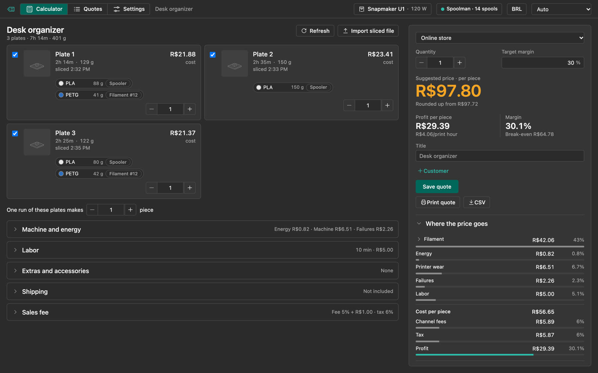
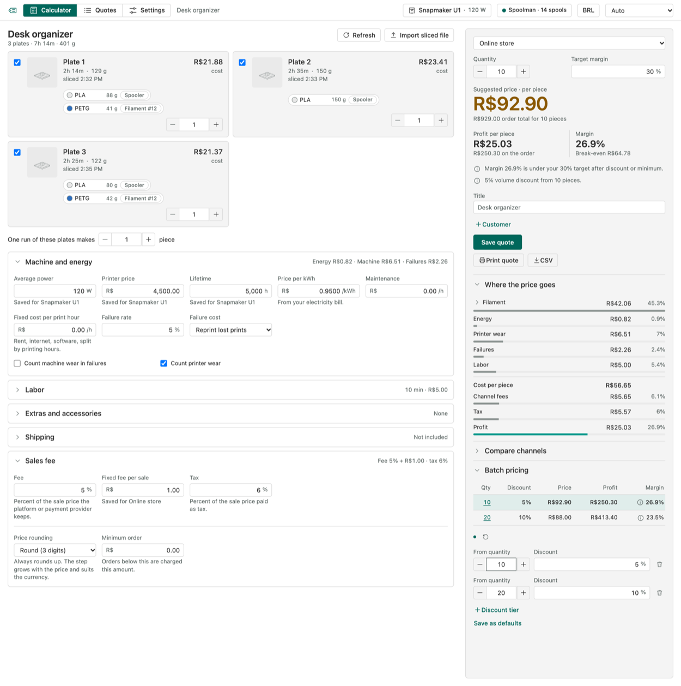
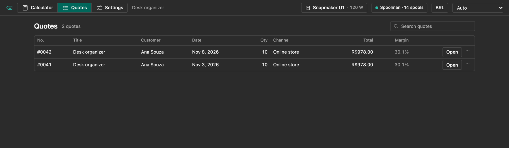
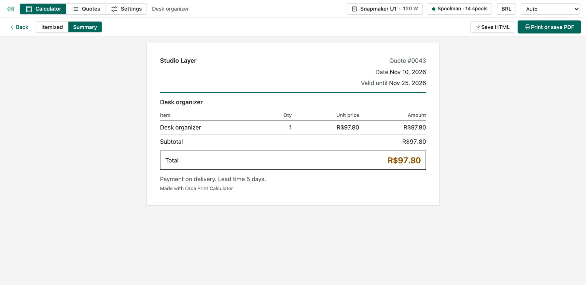
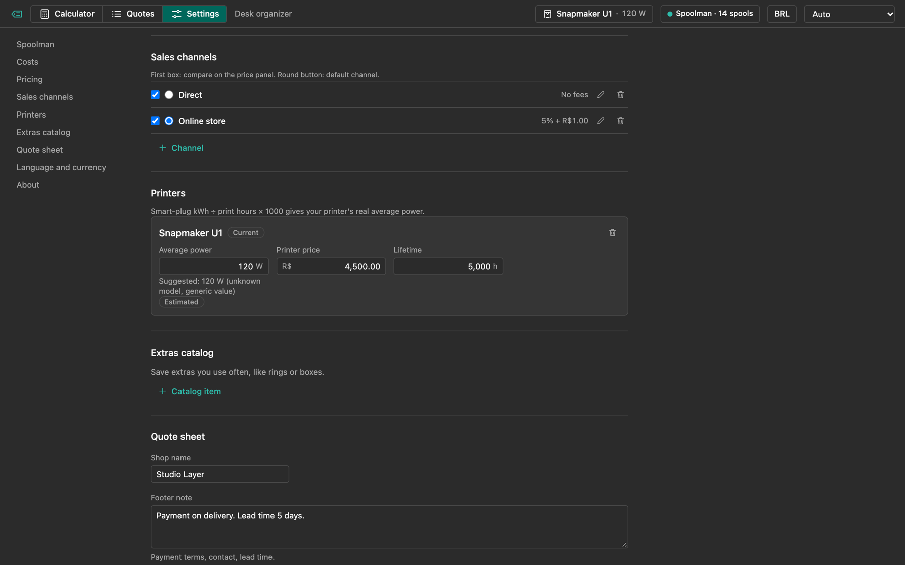
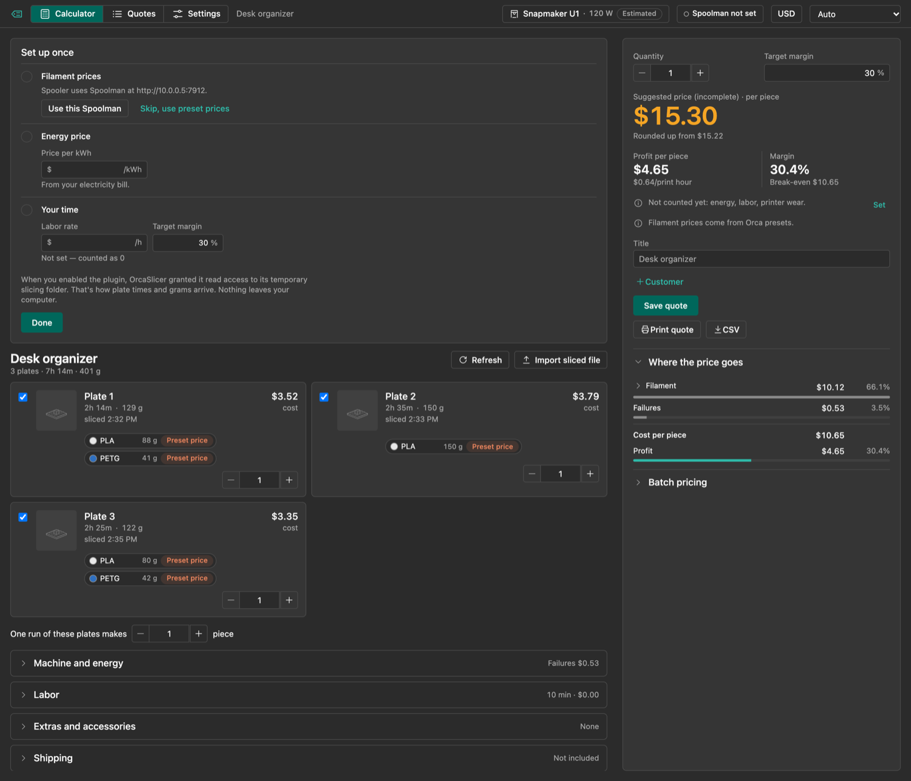
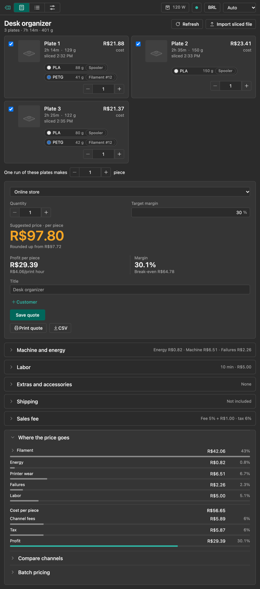
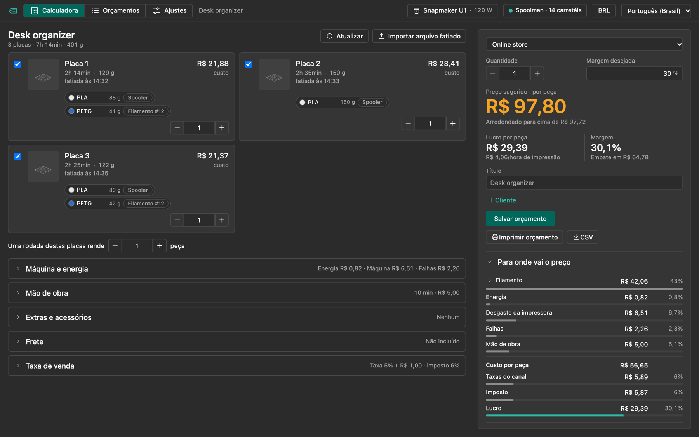

English | [Português (Brasil)](README.pt-BR.md)



# Orca Print Calculator

Orca Print Calculator is a plugin for OrcaSlicer 2.5. It adds a tab to the main window that prices every build plate of the open project. Filament cost comes from your Spoolman inventory, electricity is suggested from your printer model, and you add labor, depreciation, failure rate, extras, shipping, tax and sales-channel fees. The result is a suggested selling price, a channel comparison, batch pricing, saved quotes and a quote you can print or export for the customer.

**Status: in development. The plugin has not been run inside OrcaSlicer yet.** The interface and the pricing engine are tested outside Orca with a mock host, and the Python host is tested against a fake `orca` module. The live-run procedure is in [docs/live-run.md](docs/live-run.md). Version 0.1.0 is not released and is not on the OrcaCloud hub.

## Screenshots

















*These are screenshots of the plugin interface running in a browser with sample data and a mock host. They are not captures from inside OrcaSlicer. The plate thumbnails in the sample data are placeholders; the plugin does not show real thumbnails yet.*

## Features

- **Plates.** Each plate you slice appears with its time, filament grams per slot and cost. Every plate has an include checkbox and a copies stepper. "One run of these plates makes N pieces" sets how many pieces a full set of plates produces.
- **Slicing.** Slice a plate in OrcaSlicer and the plugin reads the G-code that Orca writes. OrcaSlicer's "Slice all" fills every plate, one after another.
- **Out-of-date warning.** Orca does not say which plate changed. When something changes after a slice, the tab marks the project "may be out of date". It misses mirroring, centering and unsaved setting changes. Slice again after those.
- **Sliced `.gcode.3mf` import.** "Import sliced file" reads plates from a file you exported with File, Export, Export all sliced file. Imported plates are replaced when you slice in Orca.
- **Filament prices.** Spoolman first, then the preset price, then a price you type. See [Spoolman matching](#spoolman-matching).
- **Printer power.** The plugin suggests average watts from the printer model and shows an "Estimated" badge. Many models have no entry, and those get a generic 120 W. Calibrate with a smart plug (kWh divided by print hours, times 1000) and type your own value. Your value wins.
- **Cost sections.** Machine and energy (power, printer price and lifetime, price per kWh, maintenance, fixed cost per print hour, failure rate), Labor, Extras and accessories (from your catalog), Shipping and Sales fee.
- **Extras and stock.** A tab for the extras catalog, with an optional count on hand per item, and a read-only summary of your Spoolman filament (spools and grams left). The calculator warns when a quote needs more of an extra than you have. Nothing is deducted automatically.
- **Sales channels.** You define them in Settings. Each has a percent fee, a fixed fee, tax and optional price tiers, for fees that change with the sale price. "Compare channels" shows them side by side. There is no marketplace integration. The fees are the numbers you type.
- **Starting values.** In BRL, USD and EUR every cost starts filled with a typical value (price per kWh, labor rate, printer price and lifetime, 5% failure rate, 100% markup). Other currencies start empty. Change any of them in Settings.
- **Pricing.** Markup over cost (100% sells for twice the cost), a minimum order amount, and four rounding modes: Exact, Round (3 digits), Ends in 9 and Ends in 0 or 5. Rounding always goes up.
- **Quantity and batches.** Quantity, discount tiers, and a batch table with unit cost, unit price, order total, order profit and margin per tier. When a run makes more pieces than the order needs, the spare pieces are charged to the order.
- **Saved quotes.** A quote keeps its own inputs, plates, prices and currency. Opening it later shows the numbers as saved, even if you changed settings or currency since.
- **Quote output.** "Print quote" opens a quote sheet (itemized or summary) and the print dialog, where you can save a PDF. CSV and HTML export write a file to the plugin data folder, and the tab shows the path. The sheet carries your logo, company details, payment terms and accent color, set in Settings › Quote sheet with a live sample beside the form.
- **Settings.** One group per tab: Spoolman, costs, pricing, sales channels, printers, quote sheet, language and currency, about. Changes save on their own.
- **Languages and currency.** English and Brazilian Portuguese. Any currency, taken from Spoolman or set in Settings.
- **Theme.** The interface is built to follow OrcaSlicer's dark and light themes. This is not verified inside Orca yet.

## Requirements

- OrcaSlicer 2.5 or newer.
- Spoolman, optional. Without it the plugin uses the filament cost stored in each preset, or a price you type.

## Install

Version 0.1.0 is on the OrcaCloud plugin hub: https://cloud.orcaslicer.com/app/plugins/shared-plugins/5f807b01-bfb8-4ad4-a77d-e85e337e4c7f. Subscribe there, then in OrcaSlicer open Plugins, refresh and enable the plugin. It has not been verified inside OrcaSlicer yet, so expect rough edges.

To try a local build on macOS instead:

1. Install Python 3.12 and pnpm.
2. Run `scripts/dev-install.sh`. It builds the wheel (`dist/orca_print_calculator_any.whl`) and copies it to `~/Library/Application Support/OrcaSlicer/orca_plugins/orca_print_calculator/`.
3. Restart OrcaSlicer, open the Plugins dialog and enable **orca_print_calculator**. OrcaSlicer shows a permission prompt. Leave full access off.

The script supports macOS only. Linux and Windows plugin paths are not verified.

## Spoolman matching

Open Settings, enter your Spoolman address (for example `http://localhost:7912`) and use Test connection. OrcaSlicer asks once whether the plugin may reach that address.

Each filament slot in the project is matched in this order. The first match wins.

1. A spool you picked by hand for that preset ("Picked").
2. The Spooler plugin mapping, if you use Spooler.
3. `(#ID)` in the filament preset name.
4. `Spoolman filament N` in the preset's `filament_notes`.
5. No match: the preset `filament_cost` per kg, labeled "Preset price". If the preset has no cost, type a price in the slot ("Typed"). A slot with no price counts as 0 and the price panel says so.

The price per kg comes from the most recently used spool that is not archived (spool price divided by initial weight). Without one it comes from the filament price divided by the filament weight.

## Permissions

| Access | Why |
|---|---|
| `threading` | Fetch from Spoolman without freezing the window. |
| Read access to OrcaSlicer's temporary slicing folder | Read the G-code Orca writes for each plate. |
| Network, only to the Spoolman address you enter | Read spools, filaments and currency. Only redirects within the same address are followed. |
| Files in the plugin's own data folder | Store settings and quotes, write exports and the log. |

The plugin does not ask for full access, and it never writes to Spoolman.

### Privacy

No telemetry. Nothing leaves your machine except requests to the Spoolman address you entered.

## Data and limits

The plugin data folder is `orca_plugins/plugin_data/<plugin name>/` inside OrcaSlicer's data folder. The `<plugin name>` is not confirmed yet (see [docs/live-run.md](docs/live-run.md)). It holds:

- `settings.json` and `quotes.json`. Each file is capped at 16 MiB when saved. If quotes grow past that, delete old ones.
- `exports/`, with the CSV and HTML files you export.
- `plugin.log`, a rotating log of 512 kB with one backup. It records plate captures and errors. It does not record your Spoolman address.

A sliced `.gcode.3mf` import is limited to 100 MB.

## Known limitations

- The plugin has not been run inside OrcaSlicer. Everything above describes the code and its tests, not a live session.
- G-code parsing for Bambu Lab printers rests on synthetic fixtures. Real Bambu output may differ. The only real fixtures come from a Snapmaker U1.
- Linux and Windows temp-folder paths, printing and the file picker are unverified.
- Plate thumbnails are not shown.
- Out-of-date detection has the blind spots listed under Features. It also does not see plates reordered by drag.
- The first slice of a plate relies on the plate that is selected when slicing ends. Switching plates during that first slice can put the numbers on the wrong plate. Later slices of the same plate are matched correctly.
- Channel fees are your numbers. Check them against each platform's current fee table. Prices from the calculator are suggestions; review them before you quote a customer.

## Troubleshooting

- **"Couldn't reach OrcaSlicer".** The tab lost its connection to the host. Reopen the tab, or restart OrcaSlicer if it repeats. "Details" shows the error.
- **Spoolman errors.** "Can't reach Spoolman at that address" means the address or network is wrong. "That address answered, but it isn't Spoolman" means a different service answered. "Access was not allowed in OrcaSlicer. Save the address again to get the prompt." means you denied the permission prompt. "Spoolman redirected to another address" means you should enter the final address. While Spoolman is offline, filament uses preset prices.
- **"Saved ... could not be read, so changes are not being saved".** The plugin cannot read `settings.json` or `quotes.json`. Check the file permissions in OrcaSlicer's data folder. The files are not overwritten.
- **"Some saved settings were invalid and were reset to defaults".** A value in `settings.json` failed validation and went back to its default. The notice names the settings.
- **No plates appear.** Slice a plate in OrcaSlicer, press Refresh, or import a sliced `.gcode.3mf`. Check `plugin.log` for `G-code read failed`.

## Development

The UI is Vue 3 with TypeScript and Vite. The host is Python 3.12 with no dependencies.

```bash
pnpm -C ui install
pnpm -C ui dev                       # UI with a mock host; pick a scenario with ?state=<name>
pnpm -C ui test                      # engine and UI tests
pnpm -C ui test:coverage             # same, with coverage thresholds
pnpm -C ui typecheck
pnpm -C ui lint
python3 -m unittest discover tests   # host tests (run scripts/build.py once first)
python3 scripts/gen_contract.py --check
python3 scripts/build.py             # build the wheel into dist/
scripts/dev-install.sh               # build and copy into OrcaSlicer (macOS)
```

`scripts/gen_contract.py` runs the real Python host against a fake `orca` module and writes the messages it exchanges to `tests/contract/*.json`. The UI tests replay those files through the real bridge and store, so the two sides cannot drift apart; `--check` fails when the committed files are stale. `scripts/dev_host.py` runs the same host behind a JSON-lines pipe, for browser smoke tests without OrcaSlicer.

Release changes are listed in [CHANGELOG.md](CHANGELOG.md).

## License

MIT. See [LICENSE](LICENSE).
