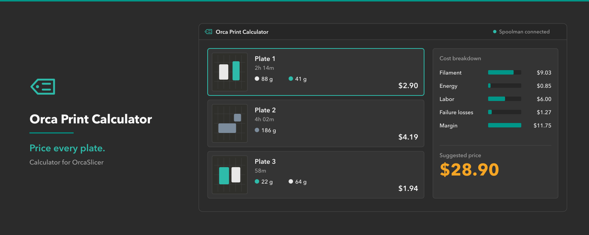
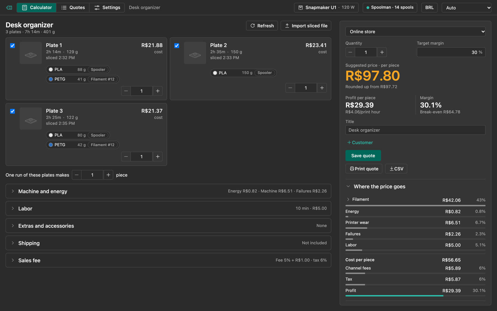
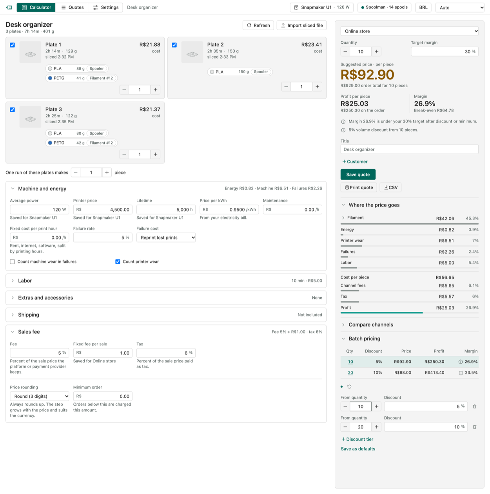
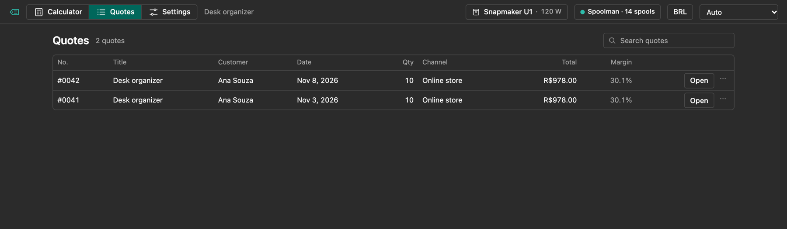
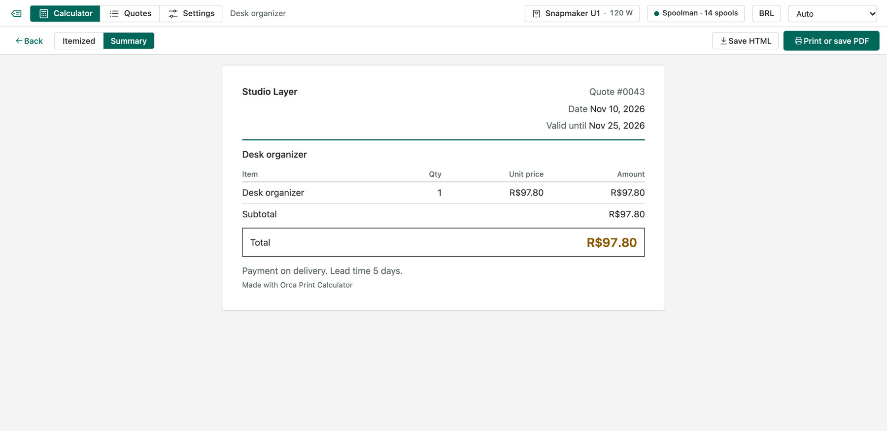
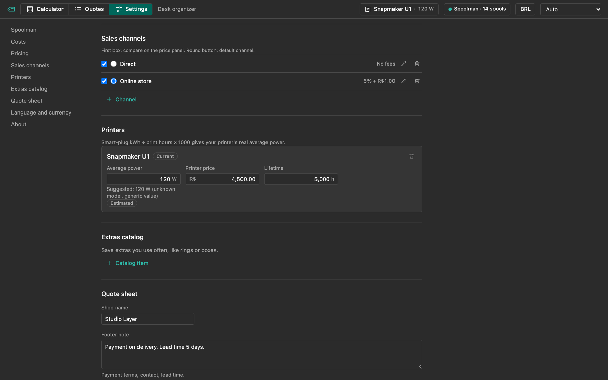
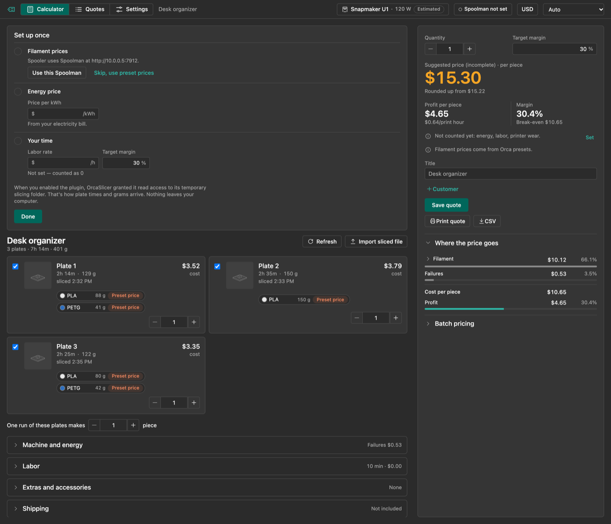
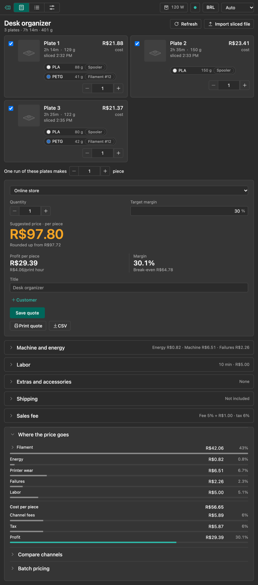
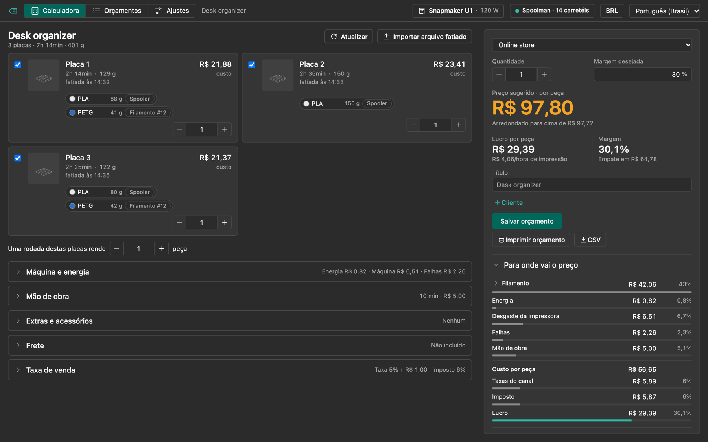

[English](README.md) | Português (Brasil)



# Orca Print Calculator

Orca Print Calculator é um plugin para o OrcaSlicer 2.5. Ele cria uma aba na janela principal que precifica cada placa do projeto aberto. O custo do filamento vem do seu estoque no Spoolman, a energia é sugerida pelo modelo da impressora, e você soma mão de obra, depreciação, taxa de falha, extras, frete, imposto e taxas dos canais de venda. O resultado é um preço de venda sugerido, a comparação entre canais, o preço por lote, orçamentos salvos e um orçamento para imprimir ou exportar para o cliente.

**Status: em desenvolvimento. O plugin ainda não foi executado dentro do OrcaSlicer.** A interface e o motor de preços são testados fora do Orca, com um host simulado, e o host em Python é testado contra um módulo `orca` falso. O roteiro do teste ao vivo está em [docs/live-run.md](docs/live-run.md) (em inglês). A versão 0.1.0 não foi lançada e não está no hub do OrcaCloud.

## Capturas de tela

















*São capturas da interface do plugin rodando no navegador, com dados de exemplo e um host simulado. Não são capturas de dentro do OrcaSlicer. As miniaturas das placas nos dados de exemplo são imagens de apoio; o plugin ainda não mostra miniaturas reais.*

## Recursos

- **Placas.** Cada placa fatiada aparece com o tempo, os gramas de filamento por slot e o custo. Cada placa tem uma caixa para incluir e um contador de cópias. "Uma rodada destas placas rende N peças" define quantas peças um conjunto completo de placas produz.
- **Fatiamento.** Fatie uma placa no OrcaSlicer e o plugin lê o G-code que o Orca gera. O "Fatiar tudo" do OrcaSlicer preenche todas as placas, uma depois da outra.
- **Aviso de desatualizado.** O Orca não diz qual placa mudou. Quando algo muda depois de um fatiamento, a aba marca o projeto como "pode estar desatualizado". Ela não percebe espelhar, centralizar e mudanças de ajuste sem salvar. Fatie de novo depois dessas ações.
- **Importar `.gcode.3mf` fatiado.** "Importar arquivo fatiado" lê as placas de um arquivo exportado em Arquivo, Exportar, Exportar todos os arquivos fatiados. As placas importadas são substituídas quando você fatia no Orca.
- **Preço do filamento.** Primeiro o Spoolman, depois o preço do perfil, depois um preço digitado por você. Veja [Correspondência com o Spoolman](#correspondência-com-o-spoolman).
- **Potência da impressora.** O plugin sugere os watts médios pelo modelo e mostra o selo "Estimado". Muitos modelos não têm entrada, e esses recebem um valor genérico de 120 W. Calibre com uma tomada inteligente (kWh dividido pelas horas de impressão, vezes 1000) e digite o seu valor. O seu valor prevalece.
- **Seções de custo.** Máquina e energia (potência, preço e vida útil da impressora, preço do kWh, manutenção, custo fixo por hora de impressão, taxa de falha), Mão de obra, Extras e acessórios (com catálogo), Frete e Taxa de venda.
- **Canais de venda.** Você define os canais em Ajustes. Cada um tem taxa percentual, taxa fixa, imposto e faixas de preço opcionais, para taxas que mudam conforme o preço de venda. "Comparar canais" mostra todos lado a lado. Não há integração com marketplaces. As taxas são os números que você digita.
- **Preço.** Margem desejada, pedido mínimo e quatro modos de arredondamento: Exato, Arredondar (3 dígitos), Termina em 9 e Termina em 0 ou 5. O arredondamento sempre sobe.
- **Quantidade e lotes.** Quantidade, faixas de desconto e uma tabela de lote com custo unitário, preço unitário, total do pedido, lucro do pedido e margem por faixa. Quando uma rodada rende mais peças do que o pedido pede, as peças a mais entram no custo do pedido.
- **Orçamentos salvos.** O orçamento guarda os próprios dados, placas, preços e moeda. Ao abrir depois, os números aparecem como foram salvos, mesmo que você tenha mudado ajustes ou moeda.
- **Saída do orçamento.** "Imprimir orçamento" abre a folha de orçamento (detalhada ou resumida) e a janela de impressão, onde dá para salvar em PDF. A exportação em CSV e em HTML grava um arquivo na pasta de dados do plugin, e a aba mostra o caminho.
- **Idiomas e moeda.** Português do Brasil e inglês. Qualquer moeda, vinda do Spoolman ou definida nos Ajustes.
- **Tema.** A interface foi feita para seguir os temas escuro e claro do OrcaSlicer. Isso ainda não foi verificado dentro do Orca.

## Requisitos

- OrcaSlicer 2.5 ou mais novo.
- Spoolman, opcional. Sem ele, o plugin usa o custo guardado em cada perfil de filamento ou um preço que você digitar.

## Instalação

Ainda não existe versão no hub. Para testar um build local no macOS:

1. Instale Python 3.12 e pnpm.
2. Rode `scripts/dev-install.sh`. Ele gera o wheel (`dist/orca_print_calculator_any.whl`) e copia para `~/Library/Application Support/OrcaSlicer/orca_plugins/orca_print_calculator/`.
3. Reinicie o OrcaSlicer, abra a janela Plugins e ative **orca_print_calculator**. O OrcaSlicer mostra um pedido de permissões. Deixe o acesso total desligado.

O script funciona só no macOS. Os caminhos de plugin no Linux e no Windows não foram verificados.

## Correspondência com o Spoolman

Abra Ajustes, informe o endereço do Spoolman (por exemplo `http://localhost:7912`) e use Testar conexão. O OrcaSlicer pergunta uma vez se o plugin pode acessar esse endereço.

Cada slot de filamento do projeto é ligado ao Spoolman nesta ordem. A primeira correspondência vale.

1. Um carretel que você escolheu à mão para aquele perfil ("Escolhido").
2. O mapeamento do plugin Spooler, se você usa o Spooler.
3. `(#ID)` no nome do perfil de filamento.
4. `Spoolman filament N` nas `filament_notes` do perfil.
5. Sem correspondência: o `filament_cost` do perfil por kg, marcado como "Preço do perfil". Se o perfil não tem custo, digite um preço no slot ("Digitado"). Um slot sem preço conta como 0 e o painel de preço avisa.

O preço por kg vem do carretel usado mais recentemente que não esteja arquivado (preço do carretel dividido pelo peso inicial). Sem carretel, vem do preço do filamento dividido pelo peso dele.

## Permissões

| Acesso | Para quê |
|---|---|
| `threading` | Buscar no Spoolman sem travar a janela. |
| Leitura na pasta temporária de fatiamento do OrcaSlicer | Ler o G-code que o Orca gera para cada placa. |
| Rede, só para o endereço do Spoolman que você informar | Ler carretéis, filamentos e moeda. Só redirecionamentos dentro do mesmo endereço são seguidos. |
| Arquivos na pasta de dados do próprio plugin | Guardar ajustes e orçamentos, gravar exportações e o log. |

O plugin não pede acesso total e nunca grava no Spoolman.

### Privacidade

Sem telemetria. Nada sai da sua máquina, a não ser as requisições ao endereço do Spoolman que você informou.

## Dados e limites

A pasta de dados do plugin é `orca_plugins/plugin_data/<nome do plugin>/`, dentro da pasta de dados do OrcaSlicer. O `<nome do plugin>` ainda não foi confirmado (veja [docs/live-run.md](docs/live-run.md)). Nela ficam:

- `settings.json` e `quotes.json`. Cada arquivo tem limite de 16 MiB ao salvar. Se os orçamentos passarem disso, apague os antigos.
- `exports/`, com os arquivos CSV e HTML que você exporta.
- `plugin.log`, um log rotativo de 512 kB com um backup. Ele registra capturas de placas e erros. Não registra o endereço do seu Spoolman.

A importação de `.gcode.3mf` fatiado tem limite de 100 MB.

## Limitações conhecidas

- O plugin ainda não foi executado dentro do OrcaSlicer. Tudo acima descreve o código e os testes dele, não uma sessão ao vivo.
- A leitura de G-code de impressoras Bambu Lab se baseia em arquivos sintéticos. A saída real da Bambu pode ser diferente. Os únicos arquivos reais vêm de uma Snapmaker U1.
- Os caminhos temporários no Linux e no Windows, a impressão e o seletor de arquivos não foram verificados.
- As miniaturas das placas não são exibidas.
- A detecção de desatualizado tem os pontos cegos listados em Recursos. Ela também não percebe placas reordenadas por arrastar.
- O primeiro fatiamento de uma placa depende da placa selecionada quando o fatiamento termina. Trocar de placa durante esse primeiro fatiamento pode colocar os números na placa errada. Os fatiamentos seguintes da mesma placa são associados corretamente.
- As taxas dos canais são os seus números. Confira com a tabela atual de cada plataforma. Os preços da calculadora são sugestões; revise antes de passar um orçamento ao cliente.

## Solução de problemas

- **"Não foi possível falar com o OrcaSlicer".** A aba perdeu a conexão com o host. Reabra a aba ou reinicie o OrcaSlicer se repetir. "Detalhes" mostra o erro.
- **Erros do Spoolman.** "Não foi possível acessar o Spoolman nesse endereço" indica endereço ou rede errados. "O endereço respondeu, mas não é o Spoolman" indica que outro serviço respondeu. "O acesso não foi permitido no OrcaSlicer. Salve o endereço de novo para ver o pedido." indica que você negou a permissão. "O Spoolman redirecionou para outro endereço" pede que você informe o endereço final. Com o Spoolman fora do ar, o filamento usa o preço dos perfis.
- **"Os dados salvos ... não puderam ser lidos, então as alterações não estão sendo salvas".** O plugin não consegue ler `settings.json` ou `quotes.json`. Confira as permissões dos arquivos na pasta de dados do OrcaSlicer. Os arquivos não são sobrescritos.
- **"Alguns ajustes salvos eram inválidos e voltaram ao padrão".** Um valor de `settings.json` não passou na validação e voltou ao padrão. O aviso diz quais ajustes.
- **Nenhuma placa aparece.** Fatie uma placa no OrcaSlicer, use Atualizar ou importe um `.gcode.3mf` fatiado. Procure `G-code read failed` no `plugin.log`.

## Desenvolvimento

A interface usa Vue 3 com TypeScript e Vite. O host é Python 3.12, sem dependências.

```bash
pnpm -C ui install
pnpm -C ui dev                       # interface com host simulado; escolha o cenário com ?state=<nome>
pnpm -C ui test                      # testes do motor e da interface
pnpm -C ui test:coverage             # os mesmos, com limites de cobertura
pnpm -C ui typecheck
pnpm -C ui lint
python3 -m unittest discover tests   # testes do host (rode scripts/build.py uma vez antes)
python3 scripts/gen_contract.py --check
python3 scripts/build.py             # gera o wheel em dist/
scripts/dev-install.sh               # gera e copia para o OrcaSlicer (macOS)
```

O `scripts/gen_contract.py` roda o host Python real contra um módulo `orca` falso e grava as mensagens trocadas em `tests/contract/*.json`. Os testes da interface reproduzem esses arquivos na ponte e no store reais, então os dois lados não se separam; o `--check` falha quando os arquivos versionados estão velhos. O `scripts/dev_host.py` roda o mesmo host atrás de um pipe de linhas JSON, para testes no navegador sem o OrcaSlicer.

As mudanças da versão estão no [CHANGELOG.md](CHANGELOG.md).

## Licença

MIT. Veja [LICENSE](LICENSE).
