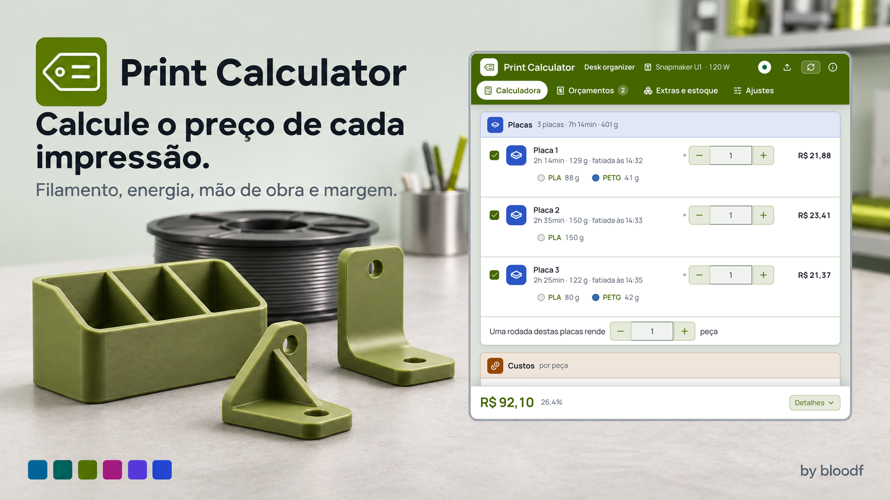
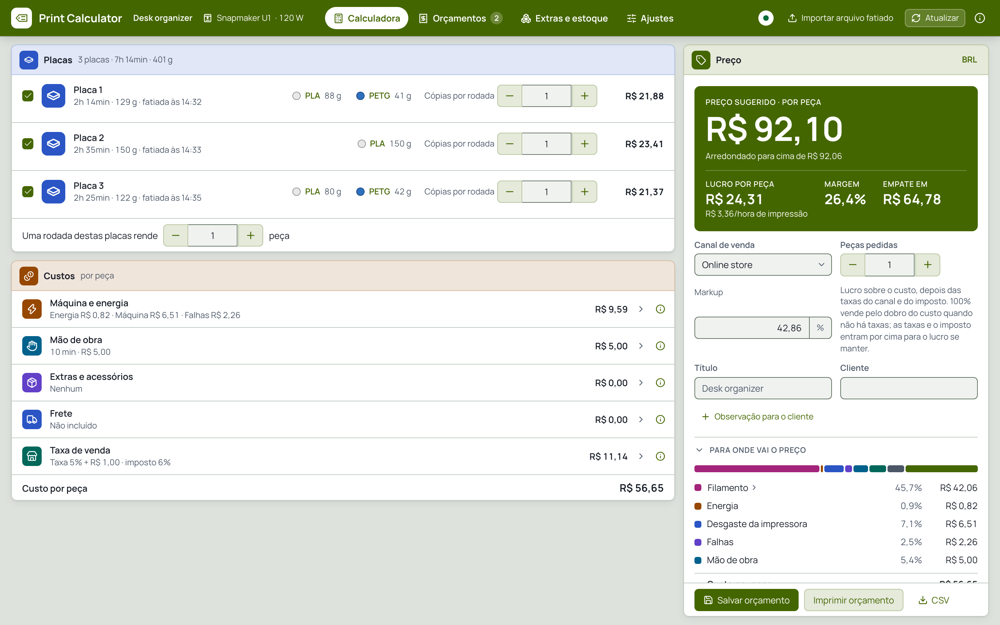
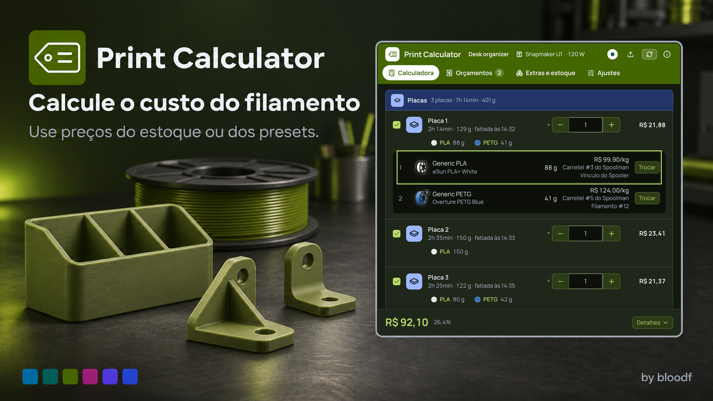
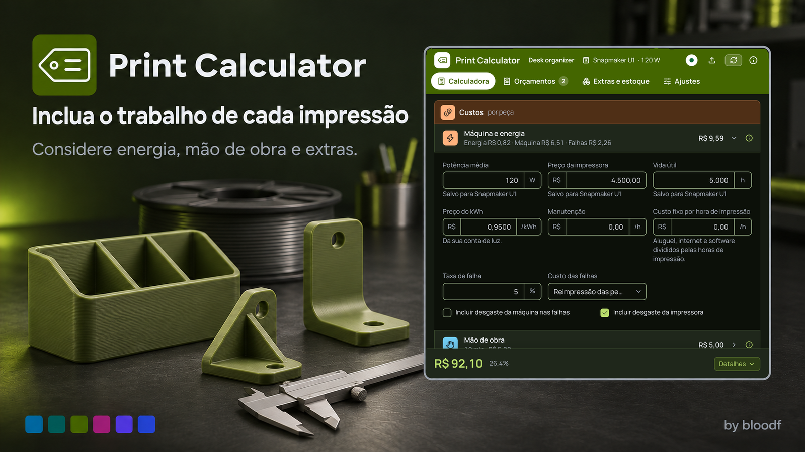
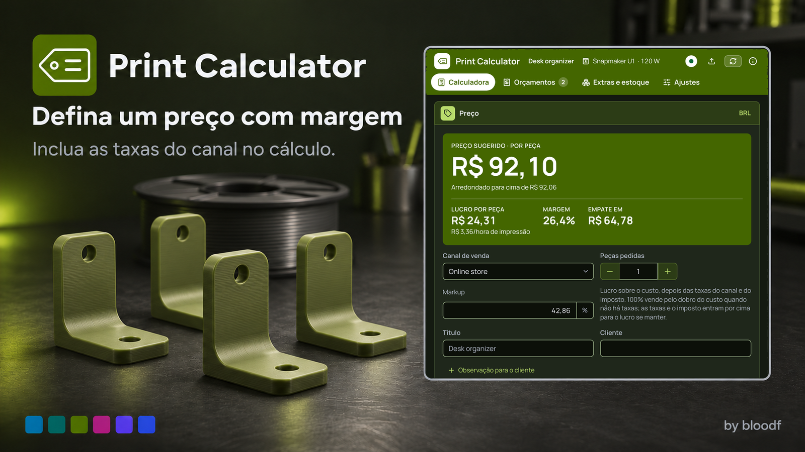
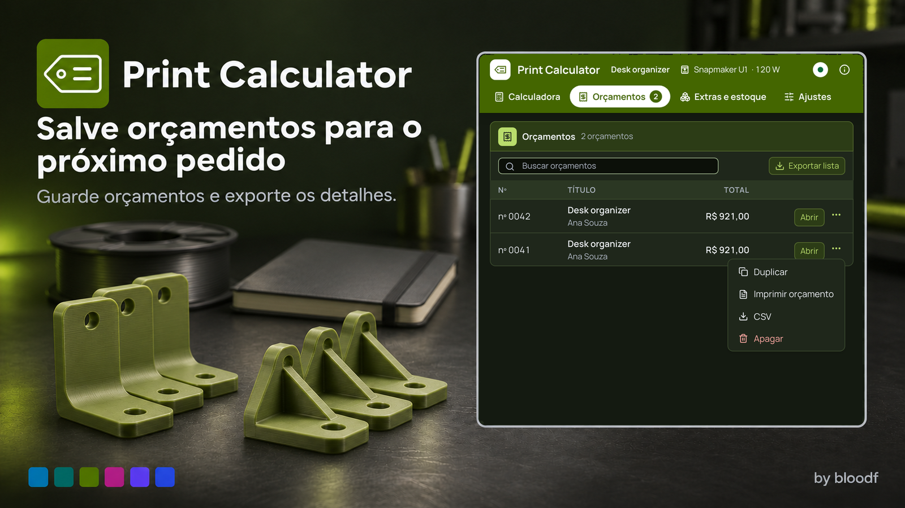
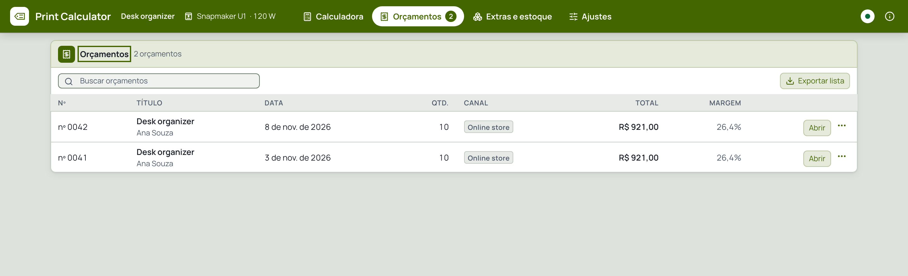

  <picture>
    <source media="(prefers-color-scheme: dark)" srcset="assets/readme/orca_print_calculator-hero-dark-pt-BR.png">
    
  </picture>

<h1 align="center">💰 Print Calculator</h1>

<b>Preço de cada mesa: filamento, energia, mão de obra, taxas e margem.</b> Um plugin para o OrcaSlicer · by bloodf

  
  
  
  

  <a href="#-instalação">Instalação</a> · <a href="#-recursos">Recursos</a> · <a href="#-como-usar">Como usar</a> · <a href="#-perguntas-frequentes">Perguntas</a> · <a href="README.md">English</a>

## ✨ O que faz

O Print Calculator cria uma aba no OrcaSlicer que precifica cada mesa do projeto aberto. Fatie uma mesa e ela aparece com o tempo de impressão, os gramas de cada filamento e quanto eles custam. O preço do filamento vem dos seus carretéis no Spoolman ou do perfil de filamento, a energia vem da potência da impressora, e você soma mão de obra, extras, frete, imposto e as taxas de onde você vende. O resultado é um preço sugerido por peça, com lucro, margem e ponto de empate, que você salva como orçamento, imprime ou exporta.

  <picture>
    <source media="(prefers-color-scheme: dark)" srcset="docs/screenshots/calculator-dark-pt-BR.png">
    
  </picture>

Todas as capturas desta página são da página do plugin num navegador, com dados de exemplo e um host simulado. Nenhuma foi feita dentro do OrcaSlicer.

## 📦 Instalação

O plugin está no Orca Cloud: [cloud.orcaslicer.com/p/521c07cf6de2](https://cloud.orcaslicer.com/p/521c07cf6de2). Assine por lá e depois, no OrcaSlicer, abra **Plugins**, atualize e ative o plugin. O Orca Cloud só lista uma versão depois que ela é publicada, então ele pode estar atrás deste repositório.

A partir de um arquivo, no macOS:

1. Baixe `orca_print_calculator_any.whl` da [última versão](https://github.com/bloodf/orca_print_calculator/releases/latest). O `SHA256SUMS` ao lado traz o checksum.
2. Copie o arquivo para `~/Library/Application Support/OrcaSlicer/orca_plugins/orca_print_calculator/` (crie a pasta e apague qualquer `.whl` antigo que esteja nela).
3. Reinicie o OrcaSlicer, abra **Plugins** e ative **orca_print_calculator**. O OrcaSlicer mostra um pedido de permissões. Deixe o acesso total desligado.

No Linux e no Windows a pasta é `orca_plugins/orca_print_calculator/`, dentro da pasta de dados do OrcaSlicer. Esses caminhos não foram verificados.

| Requisito | |
|---|---|
| OrcaSlicer | 2.5 ou mais novo |
| Spoolman | Opcional. Sem ele, o plugin usa o custo guardado em cada perfil de filamento ou um preço que você digitar |
| Impressora | Qualquer uma. Só o G-code de uma Snapmaker U1 foi conferido com arquivos reais (veja as [perguntas frequentes](#-perguntas-frequentes)) |
| Status | Em desenvolvimento. Testado com um host simulado, ainda não verificado dentro do OrcaSlicer ([roteiro do teste ao vivo](docs/live-run.md), em inglês) |

## 🧰 Recursos

<table>
  <tr>
    <td width="50%" valign="top">
       
      <b>Custo do filamento</b> 
      Cada slot de filamento recebe o preço por kg do carretel do Spoolman correspondente. Sem correspondência, vale um preço digitado por você ou o custo do perfil, e a aba diz qual.
    </td>
    <td width="50%" valign="top">
       
      <b>Máquina, energia e mão de obra</b> 
      Potência da impressora, preço do kWh, desgaste da impressora, taxa de falha, mão de obra, extras e frete entram no custo de cada peça.
    </td>
  </tr>
  <tr>
    <td width="50%" valign="top">
       
      <b>Preço com margem</b> 
      Um markup sobre o custo dá um preço por peça que mantém o lucro depois da taxa do canal e do imposto, com a margem e o empate ao lado.
    </td>
    <td width="50%" valign="top">
       
      <b>Orçamentos salvos</b> 
      O orçamento guarda as próprias mesas, preços e moeda. Abra depois, duplique, imprima ou exporte.
    </td>
  </tr>
</table>

| | Recurso | O que você tem |
|---|---|---|
| | Placas | Uma linha por mesa fatiada, com tempo, gramas por slot de filamento e custo, uma caixa para incluir e um contador de cópias. "Uma rodada destas mesas rende N peças" define quantas peças um conjunto completo de mesas produz. |
| | Fatiamento | O plugin lê o G-code que o OrcaSlicer gera quando você fatia. O "Fatiar tudo" preenche todas as mesas, uma depois da outra. |
| | Aviso de desatualizado | Quando algo muda depois de um fatiamento, a aba marca o projeto como "pode estar desatualizado". |
| | Importar arquivo fatiado | **Importar arquivo fatiado** lê as mesas de um `.gcode.3mf` exportado em Arquivo, Exportar, Exportar todos os arquivos fatiados (até 100 MB). As mesas importadas continuam na tela quando você fatia; um aviso de "Novo fatiamento" oferece "Usar". |
| | Potência da impressora | Os watts médios são sugeridos pelo modelo da impressora, com o selo "Estimado". Modelos sem entrada recebem 120 W genéricos. O seu valor prevalece. |
| | Seções de custo | **Máquina e energia** (potência, preço e vida útil da impressora, preço do kWh, manutenção, custo fixo por hora de impressão, taxa de falha), **Mão de obra**, **Extras e acessórios**, **Frete** e **Taxa de venda**. |
| | Extras e estoque | Um catálogo de extras com a quantidade em estoque opcional e um resumo somente leitura do filamento no Spoolman. A calculadora avisa quando um orçamento precisa de mais do que você tem. Nada é descontado. |
| | Canais de venda | Os seus canais, cada um com taxa percentual, taxa fixa, imposto e faixas de preço opcionais. **Comparar canais** mostra todos lado a lado. |
| | Arredondamento e mínimo | Pedido mínimo e quatro modos de arredondamento: Exato, Arredondar (3 dígitos), Termina em 9, Termina em 0 ou 5. O arredondamento sempre sobe. |
| | Preço por lote | Quantidade, faixas de desconto e uma tabela com custo unitário, preço unitário, total do pedido, lucro do pedido e margem por faixa. |
| | Folha de orçamento | **Imprimir orçamento** abre a folha detalhada ou resumida e a janela de impressão, onde dá para salvar em PDF. A folha leva seu logo, dados da empresa, condições de pagamento e cor de destaque. |
| | Exportação | Os arquivos CSV e HTML vão para a pasta de dados do plugin, e a aba mostra o caminho. **Exportar lista**, na aba Orçamentos, grava uma linha de CSV por orçamento listado. |
| | Valores iniciais | Em BRL, USD e EUR todo custo começa com um valor típico (preço do kWh, mão de obra, preço e vida útil da impressora, 5% de falha, 100% de markup). Outras moedas começam vazias. |
| | Ajustes | Uma página com todos os grupos (Spoolman, custos, preço, canais de venda, impressoras, folha de orçamento, idioma e moeda, sobre) e um índice que leva a cada um. As alterações são salvas sozinhas. |
| | Moeda e tema | Qualquer moeda, vinda do Spoolman ou definida nos Ajustes. A página foi feita para seguir os temas escuro e claro do OrcaSlicer, em lima com uma barra verde-escura; isso ainda não foi verificado dentro do OrcaSlicer. |

## 🛠️ Como usar

1. Abra a aba **Print Calculator**. No primeiro uso, **Configure uma vez** pede três coisas: o preço do filamento (conecte o Spoolman, ou pule e use o preço dos perfis), o preço da energia e o valor da sua hora. Se o Spooler estiver instalado, ele oferece o endereço do Spoolman que o Spooler já usa.
2. Para conectar o Spoolman depois, abra **Ajustes**, digite o **Endereço do Spoolman** (por exemplo `http://localhost:7912`) e use **Testar conexão**. O OrcaSlicer pergunta uma vez se o plugin pode acessar esse endereço.
3. Fatie uma mesa, ou use "Fatiar tudo". Cada mesa aparece em **Placas**. Use **Atualizar** se faltar alguma, ou **Importar arquivo fatiado** para um `.gcode.3mf`.
4. Clique nos filamentos de uma mesa para ver o preço por kg de cada slot. **Trocar** escolhe outro carretel ou deixa você digitar um preço por kg.
5. Abra as seções em **Custos** e preencha o que se aplica: **Máquina e energia**, **Mão de obra**, **Extras e acessórios**, **Frete**, **Taxa de venda**.
6. Em **Preço**, escolha o **Canal de venda**, as **Peças pedidas** e o **Markup**. **Para onde vai o preço** divide o preço por linha de custo, taxas, imposto e lucro.
7. Use **Salvar orçamento**. Depois, **Imprimir orçamento** para uma folha ou um PDF, ou **CSV** para um arquivo. Os orçamentos salvos ficam na aba **Orçamentos**.

  <picture>
    <source media="(prefers-color-scheme: dark)" srcset="docs/screenshots/quotes-dark-pt-BR.png">
    
  </picture>

## 🔒 Privacidade e segurança

Sem telemetria. Nada sai da sua máquina, a não ser as requisições ao endereço do Spoolman que você informou. O plugin só lê do Spoolman e nunca grava nele. Ele não se conecta a nenhum marketplace: as taxas dos canais são os números que você digita.

| Acesso | Para quê |
|---|---|
| `threading` | Buscar no Spoolman sem travar a janela. |
| Leitura na pasta temporária de fatiamento do OrcaSlicer | Ler o G-code que o OrcaSlicer gera para cada mesa. |
| Rede, só para o endereço do Spoolman que você informar | Ler carretéis, filamentos e moeda. Só redirecionamentos dentro do mesmo endereço são seguidos. |
| Arquivos na pasta de dados do próprio plugin | Guardar ajustes e orçamentos, gravar exportações e o log. |

O plugin não pede acesso total.

A pasta de dados dele é `orca_plugins/plugin_data/<nome do plugin>/`, dentro da pasta de dados do OrcaSlicer. O `<nome do plugin>` ainda não foi confirmado (veja [docs/live-run.md](docs/live-run.md)).

| Arquivo | O que guarda |
|---|---|
| `settings.json`, `quotes.json` | Seus ajustes e orçamentos salvos. Cada arquivo tem limite de 16 MiB ao salvar; se os orçamentos passarem disso, apague os antigos. |
| `exports/` | Os arquivos CSV e HTML que você exporta. |
| `plugin.log` | Um log rotativo de 512 kB com um backup. Registra capturas de mesas e erros, e nunca o endereço do seu Spoolman. |

Os preços da calculadora são sugestões. Revise antes de passar um orçamento ao cliente e confira as taxas dos canais com a tabela atual de cada plataforma.

## ❓ Perguntas frequentes

Como ligo um slot de filamento a um carretel do Spoolman?

Clique nos filamentos de uma mesa, depois em **Trocar** no slot, e escolha um carretel ou digite um preço por kg. Sem essa escolha, cada slot é ligado nesta ordem, e a primeira correspondência vale:

1. Um carretel que você escolheu à mão para aquele perfil ("Escolhido").
2. O mapeamento do plugin Spooler, se você usa o Spooler.
3. `(#ID)` no nome do perfil de filamento.
4. `Spoolman filament N` nas `filament_notes` do perfil.
5. Sem correspondência: um preço por kg digitado por você para esse perfil ("Digitado"), senão o `filament_cost` do perfil por kg, marcado como "Preço do perfil".

Um slot sem preço conta como 0 e o painel de preço avisa. Um slot ligado a um filamento do Spoolman sem preço (nenhum carretel com preço, nenhum preço no filamento) segue a mesma regra: preço digitado, depois preço do perfil.

O preço por kg vem do carretel usado mais recentemente que não esteja arquivado (preço do carretel dividido pelo peso inicial). Sem carretel, vem do preço do filamento dividido pelo peso dele.

Como o preço sugerido é calculado?

Markup sobre o custo. O preço sugerido é o menor preço cujo lucro, depois das taxas do canal e do imposto, é pelo menos o markup vezes o custo. Sem taxas, 100% vende pelo dobro do custo. Num canal com taxa de 20%, um custo de 10,00 vende a 25,00, e os 10,00 de lucro ficam depois da taxa. Os números de "Margem" são o lucro como parte do preço.

Como as taxas do canal são cobradas num pedido de várias peças?

As taxas são calculadas sobre o preço de uma peça e multiplicadas pela quantidade. A taxa fixa vale por peça vendida, não uma vez por pedido, e as faixas de preço escolhem a faixa pelo preço por peça.

O que acontece quando uma rodada rende mais peças do que o pedido pede?

As peças a mais entram no custo do pedido. Cada linha de custo é arredondada uma vez sobre o pedido inteiro, não por peça (versão de cálculo 2), e o markup é medido sobre o custo depois das taxas e do imposto (versão de cálculo 3). Orçamentos salvos antes mantêm os números com que foram salvos. "Reprecificar com o cálculo atual", nas notas do próprio orçamento, aplica o cálculo atual de propósito.

Por que não consigo imprimir ou exportar um orçamento?

O que o fatiamento não informou (tempo de impressão, peso ou uso de filamento, preço do filamento) é salvo como desconhecido, nunca como zero. Dá para salvar esse rascunho, mas ele não pode ser exportado, impresso nem enviado enquanto estiver incompleto. A lista abaixo do preço diz o que falta.

Um orçamento salvo muda quando eu mudo os ajustes?

Não. O orçamento guarda os próprios dados, mesas, preços e moeda. Ao abrir depois, os números aparecem como foram salvos, mesmo que você tenha mudado ajustes ou moeda.

Como descubro a potência certa da minha impressora?

Meça uma impressão com uma tomada inteligente: kWh dividido pelas horas de impressão, vezes 1000, dá os watts médios. Digite esse valor e ele substitui a estimativa.

O que o aviso de estoque conta?

Nos extras, todas as linhas do mesmo item somadas: por peça (inclusive as sobras), por cópia de mesa e rodada, e por pedido. No filamento, a aba avisa quando um orçamento imprime mais de um filamento do Spoolman do que os carretéis não arquivados ainda têm, contando cada cópia de mesa e rodada. Filamento sem peso restante no Spoolman não é verificado. Nada é descontado sozinho.

O que o aviso "pode estar desatualizado" não percebe?

O OrcaSlicer não diz qual mesa mudou, então a aba marca o projeto inteiro. Ela não percebe espelhar, centralizar, mudanças de ajuste sem salvar e mesas reordenadas por arrastar. Fatie de novo depois dessas ações.

O plugin já foi testado dentro do OrcaSlicer?

Ainda não. A página e o motor de preços são testados fora do OrcaSlicer, com um host simulado, e o host em Python contra um módulo `orca` falso. Nada foi executado contra um OrcaSlicer, servidor Spoolman ou impressora reais. O roteiro para isso está em [docs/live-run.md](docs/live-run.md) (em inglês).

Limites conhecidos até lá:

- A leitura de G-code de impressoras Bambu Lab se baseia em arquivos sintéticos, e a saída real da Bambu pode ser diferente. Os únicos arquivos reais vêm de uma Snapmaker U1.
- Os caminhos temporários no Linux e no Windows, a impressão e o seletor de arquivos não foram verificados.
- As miniaturas das mesas não são exibidas.
- O primeiro fatiamento de uma mesa depende da mesa selecionada quando o fatiamento termina. Trocar de mesa durante esse primeiro fatiamento pode colocar os números na mesa errada. Os fatiamentos seguintes da mesma mesa são associados corretamente.
- A API de plugins do OrcaSlicer não permite juntar nem esconder abas, então esta aba fica ao lado das de outros plugins (Spooler, U1 Control).

Nenhuma mesa aparece. E agora?

Fatie uma mesa no OrcaSlicer, use **Atualizar** ou importe um `.gcode.3mf` fatiado. Procure `G-code read failed` no `plugin.log`.

O que significam os erros do Spoolman?

"Não foi possível acessar o Spoolman nesse endereço" indica endereço ou rede errados. "O endereço respondeu, mas não é o Spoolman" indica que outro serviço respondeu. "O acesso não foi permitido no OrcaSlicer. Salve o endereço de novo para ver o pedido." indica que você negou a permissão. "O Spoolman redirecionou para outro endereço" pede que você informe o endereço final. Com o Spoolman fora do ar, o filamento usa o preço dos perfis.

O que significam as outras mensagens de erro?

"Não foi possível falar com o OrcaSlicer": a aba perdeu a conexão com o host. Reabra a aba ou reinicie o OrcaSlicer se repetir. "Detalhes" mostra o erro.

"Os dados salvos ... não puderam ser lidos, então as alterações não estão sendo salvas": o plugin não consegue ler `settings.json` ou `quotes.json`. Confira as permissões dos arquivos na pasta de dados do OrcaSlicer. Os arquivos não são sobrescritos.

"Alguns ajustes salvos eram inválidos e voltaram ao padrão": um valor de `settings.json` não passou na validação e voltou ao padrão. O aviso diz quais ajustes.

## 🌍 Idiomas

Português do Brasil e inglês, trocados nos Ajustes.

## 🧩 Mais plugins do bloodf

| | Plugin | O que faz | |
|---|---|---|---|
|  | 🧩 [Organizer](https://github.com/bloodf/orca_organizer) | Organize as peças pelo contorno real e encha a mesa com mais cópias. | [Instalar](https://cloud.orcaslicer.com/p/5bf381fd42d4) |
|  | 🧲 [Embedder](https://github.com/bloodf/embedder) | Bolsos para ímãs e NFC, com a pausa na camada certa. | [Instalar](https://cloud.orcaslicer.com/p/58222d4f9e52) |
|  | 💰 Print Calculator · você está aqui | Preço de cada mesa: filamento, energia, mão de obra, taxas e margem. | [Instalar](https://cloud.orcaslicer.com/p/521c07cf6de2) |
|  | 🧵 [Spooler](https://github.com/bloodf/spooler) | Seu estoque do Spoolman dentro do OrcaSlicer, com o que resta em cada bobina. | [Instalar](https://cloud.orcaslicer.com/p/50c35dcbd6f3) |
|  | 🟣 [Kobra Control](https://github.com/bloodf/kobracontrol) | Controle a Anycubic Kobra X pelo OrcaSlicer na sua rede. | [Instalar](https://cloud.orcaslicer.com/p/59c786285255) |
|  | 🔵 [U1 Control](https://github.com/bloodf/u1control) | Controle a Snapmaker U1 pelo OrcaSlicer: cabeças, câmera, arquivos. | [Instalar](https://cloud.orcaslicer.com/p/55b8c347d443) |

Cada plugin funciona sozinho; instalados juntos, compartilham dados onde ajuda.

## 🤝 Como contribuir

Comece pelo [CONTRIBUTING.md](CONTRIBUTING.md). Build, testes e o contrato com o host estão em [docs/development.md](docs/development.md), a publicação de versões em [docs/release.md](docs/release.md), a especificação da interface em [docs/ux.md](docs/ux.md) e as regras da marca em [brand/BRAND.md](brand/BRAND.md). Esses documentos estão em inglês. As mudanças de cada versão estão no [CHANGELOG.md](CHANGELOG.md).

## 📄 Licença

MIT. Veja [LICENSE](LICENSE).

by bloodf

