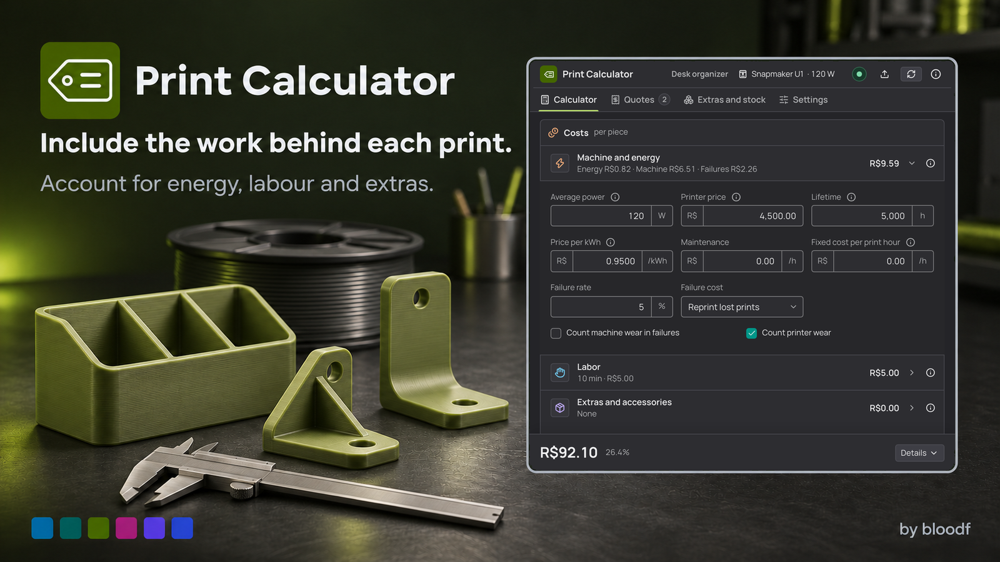
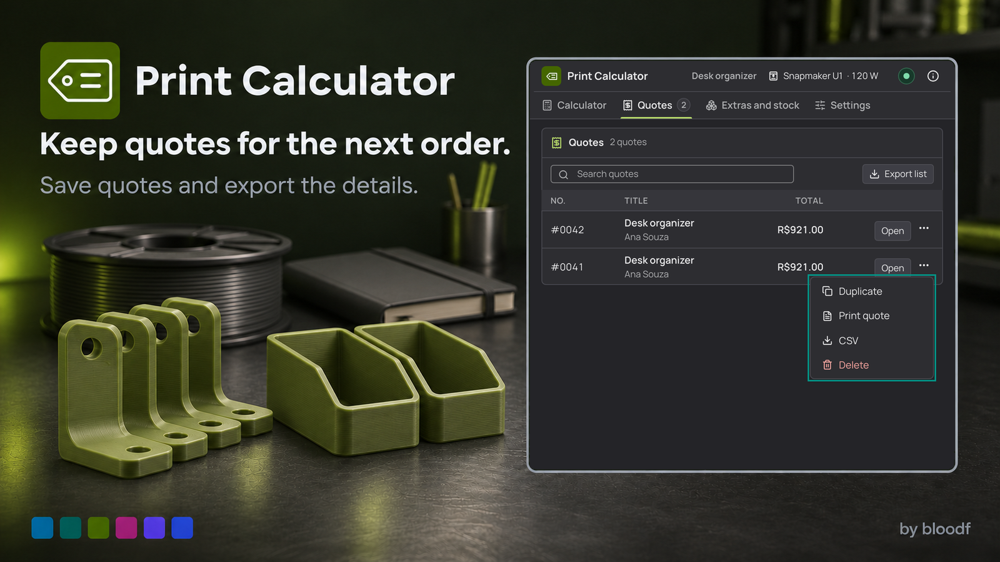

# Orca Cloud description

The text of the plugin page on Orca Cloud: <https://cloud.orcaslicer.com/p/521c07cf6de2>. Paste the block as it is. The images to upload with it are listed in [release.md](release.md#orca-cloud-listing).

The listing is English only and stays well under Orca Cloud's 4000 characters; the full description is [README.md](../README.md). The feature images are linked from the `main` branch of this repository, so they show once the files are on `main`. The screenshots inside them are the plugin's page in a browser with sample data and a mock host, not captures from inside OrcaSlicer.

```markdown
Price every plate: filament, energy, labour, fees and margin.

Full description: https://github.com/bloodf/orca_print_calculator/blob/main/README.md

## What it does

- Lists every sliced plate with print time, grams per filament and cost. "Slice all" fills the project, or import a sliced .gcode.3mf.
- Prices filament per kg from your Spoolman spools, a price you type, or the preset cost, and says which one it used.
- Adds energy, printer wear, failures, labour, extras, shipping and tax to every piece.
- Suggests a price that keeps your markup after each sales channel's fee and tax. Compare channels side by side.
- Saves quotes with their own numbers. Print one, save it as PDF, or export CSV and HTML.






## Install

1. Subscribe on this page.
2. In OrcaSlicer open Plugins, refresh and enable Print Calculator. Leave full access off. macOS: File > Plugins. Windows and Linux: the ▾ next to File > Plugins.
3. Open the Print Calculator tab, answer "Set up once", then slice a plate.

Needs OrcaSlicer 2.5 or newer. Spoolman is optional.

## Privacy

No telemetry. The only network requests go to the Spoolman address you enter, and the plugin never writes to Spoolman.

More plugins by bloodf: [Organizer](https://cloud.orcaslicer.com/p/5bf381fd42d4) · [Embedder](https://cloud.orcaslicer.com/p/58222d4f9e52) · [Spooler](https://cloud.orcaslicer.com/p/50c35dcbd6f3) · [U1 Control](https://cloud.orcaslicer.com/p/55b8c347d443) · [Kobra Control](https://cloud.orcaslicer.com/p/59c786285255)
```
