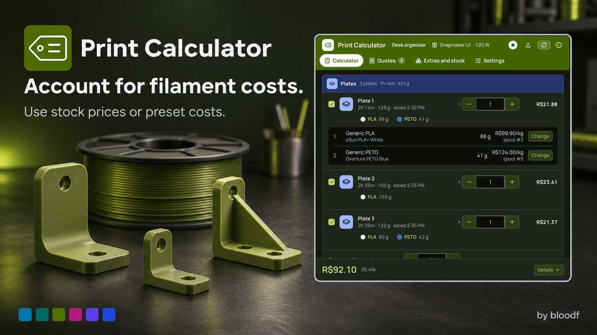
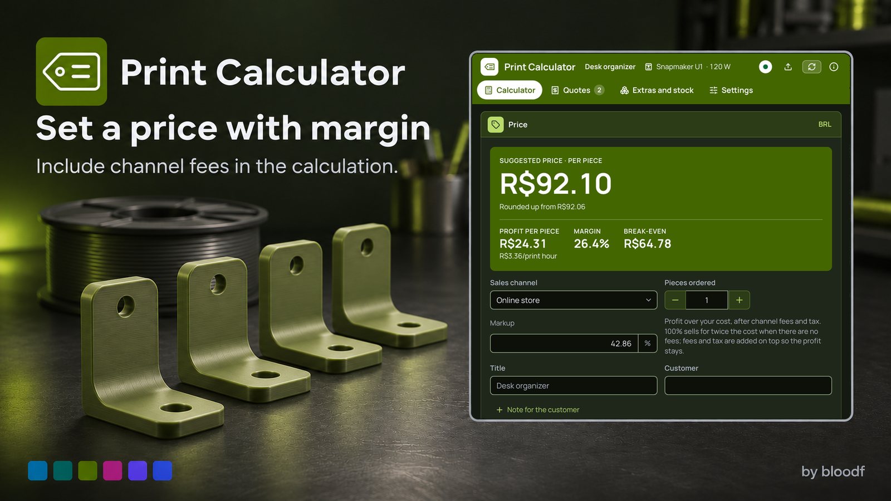
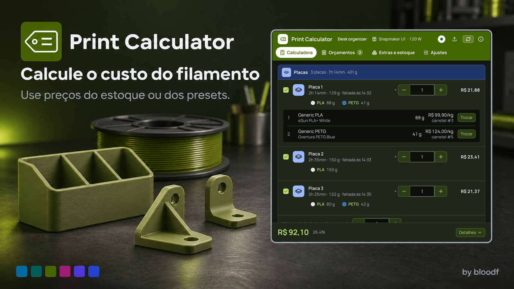
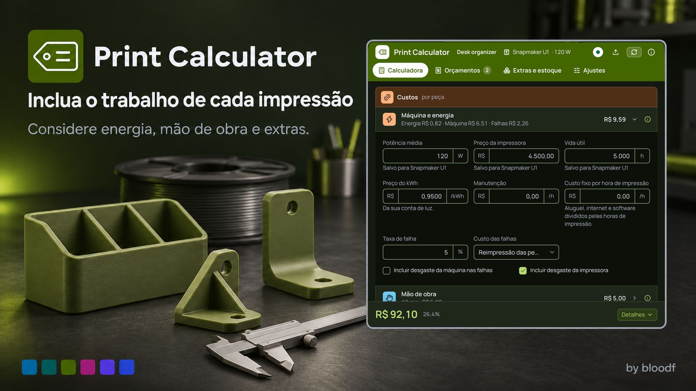
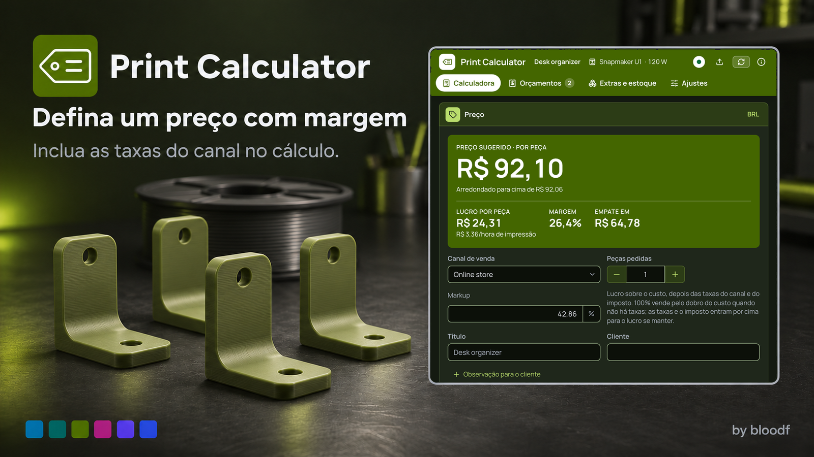
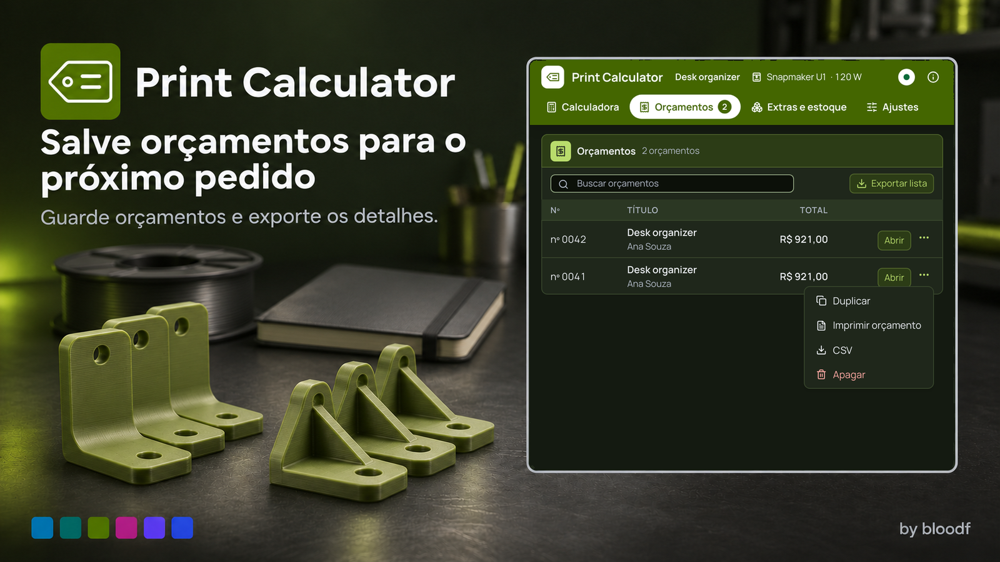

# Orca Cloud description

The text of the plugin page on Orca Cloud: <https://cloud.orcaslicer.com/p/521c07cf6de2>. Paste each block as it is. The images to upload with it are listed in [release.md](release.md#orca-cloud-listing).

Each language stays under 4000 characters. The feature images are linked from the `main` branch of this repository, so they show once the files are on `main`. The screenshots inside them are the plugin's page in a browser with sample data and a mock host, not captures from inside OrcaSlicer.

## English

Short description (114 characters, limit 140):

```text
Prices every build plate in OrcaSlicer: Spoolman filament cost, energy, labor, fees and a suggested selling price.
```

Description:

```markdown
Price every plate: filament, energy, labour, fees and margin.

## What you need

- OrcaSlicer 2.5 or newer.
- Optional: a Spoolman server. Without it the plugin uses the cost in each filament preset, or a price you type.
- Status: in development. Tested with a mock host, not yet verified inside OrcaSlicer. G-code parsing for Bambu Lab printers rests on synthetic files.

## What it does

- Every sliced plate appears with its print time, the grams of each filament and its cost. "Slice all" fills the whole project, or you import a sliced .gcode.3mf.
- Filament is priced per kg from your Spoolman spools, from a price you type, or from the preset cost, and the tab says which.
- Energy, printer wear, failure rate, labour, extras, shipping and tax are added to every piece.
- A markup gives a suggested price that keeps its profit after your sales channel's fee and tax. You define the channels and compare them side by side.
- Quotes are saved with their own numbers. Print one, save it as PDF, or export CSV and HTML.






## How to start

1. Subscribe on this page. In OrcaSlicer open Plugins, refresh and enable the plugin. Leave full access off.
2. Open the Print Calculator tab and answer "Set up once": filament prices, energy price and your hourly rate.
3. Slice a plate. It appears under Plates, and the Price panel shows the suggested price per piece.

## Privacy

No telemetry. Nothing leaves your machine except requests to the Spoolman address you enter, and the plugin never writes to Spoolman. Permissions: threading, read access to OrcaSlicer's temporary slicing folder, network access only to that Spoolman address, and files only in the plugin's own data folder. It is not connected to any marketplace: channel fees are the numbers you type.

## Languages

English and Brazilian Portuguese. Any currency.

## More plugins by bloodf

- [Organizer](https://cloud.orcaslicer.com/p/5bf381fd42d4): Arrange parts by their real outline and fill a plate with more copies.
- [Embedder](https://cloud.orcaslicer.com/p/58222d4f9e52): Magnet and NFC pockets, with the pause at the right layer.
- [Spooler](https://cloud.orcaslicer.com/p/50c35dcbd6f3): Your Spoolman stock inside OrcaSlicer, with what is left on each spool.
- [Kobra Control](https://cloud.orcaslicer.com/p/59c786285255): Run the Anycubic Kobra X from OrcaSlicer over your LAN.
- [U1 Control](https://cloud.orcaslicer.com/p/55b8c347d443): Run the Snapmaker U1 from OrcaSlicer: toolheads, camera, files.

Each plugin works on its own; installed together they share data where it helps. Print Calculator uses Spooler's Spoolman address and filament mapping.

## Source code

https://github.com/bloodf/orca_print_calculator (MIT)
```

## Português (Brasil)

Descrição curta (113 caracteres, limite 140):

```text
Precifica cada placa no OrcaSlicer: filamento do Spoolman, energia, mão de obra, taxas e preço de venda sugerido.
```

Descrição:

```markdown
Preço de cada placa: filamento, energia, mão de obra, taxas e margem.

## O que você precisa

- OrcaSlicer 2.5 ou mais novo.
- Opcional: um servidor Spoolman. Sem ele, o plugin usa o custo de cada perfil de filamento ou um preço que você digitar.
- Status: em desenvolvimento. Testado com um host simulado, ainda não verificado dentro do OrcaSlicer. A leitura de G-code de impressoras Bambu Lab se baseia em arquivos sintéticos.

## O que faz

- Cada placa fatiada aparece com o tempo de impressão, os gramas de cada filamento e o custo. O "Fatiar tudo" preenche o projeto inteiro, ou você importa um .gcode.3mf fatiado.
- O filamento recebe o preço por kg dos seus carretéis no Spoolman, de um preço digitado por você ou do custo do perfil, e a aba diz qual.
- Energia, desgaste da impressora, taxa de falha, mão de obra, extras, frete e imposto entram no custo de cada peça.
- Um markup dá um preço sugerido que mantém o lucro depois da taxa e do imposto do seu canal de venda. Você define os canais e compara todos lado a lado.
- Os orçamentos são salvos com os próprios números. Imprima, salve em PDF ou exporte CSV e HTML.






## Como começar

1. Assine nesta página. No OrcaSlicer, abra Plugins, atualize e ative o plugin. Deixe o acesso total desligado.
2. Abra a aba Print Calculator e responda ao "Configure uma vez": preço do filamento, preço da energia e o valor da sua hora.
3. Fatie uma placa. Ela aparece em Placas, e o painel Preço mostra o preço sugerido por peça.

## Privacidade

Sem telemetria. Nada sai da sua máquina, a não ser as requisições ao endereço do Spoolman que você informar, e o plugin nunca grava no Spoolman. Permissões: threading, leitura na pasta temporária de fatiamento do OrcaSlicer, rede só para esse endereço do Spoolman e arquivos só na pasta de dados do próprio plugin. Ele não se conecta a nenhum marketplace: as taxas dos canais são os números que você digita.

## Idiomas

Português do Brasil e inglês. Qualquer moeda.

## Mais plugins do bloodf

- [Organizer](https://cloud.orcaslicer.com/p/5bf381fd42d4): Organize as peças pelo contorno real e encha a mesa com mais cópias.
- [Embedder](https://cloud.orcaslicer.com/p/58222d4f9e52): Bolsos para ímãs e NFC, com a pausa na camada certa.
- [Spooler](https://cloud.orcaslicer.com/p/50c35dcbd6f3): Seu estoque do Spoolman dentro do OrcaSlicer, com o que resta em cada bobina.
- [Kobra Control](https://cloud.orcaslicer.com/p/59c786285255): Controle a Anycubic Kobra X pelo OrcaSlicer na sua rede.
- [U1 Control](https://cloud.orcaslicer.com/p/55b8c347d443): Controle a Snapmaker U1 pelo OrcaSlicer: cabeças, câmera, arquivos.

Cada plugin funciona sozinho; instalados juntos, compartilham dados onde ajuda. O Print Calculator usa o endereço do Spoolman e o mapeamento de filamentos do Spooler.

## Código-fonte

https://github.com/bloodf/orca_print_calculator (MIT)
```
